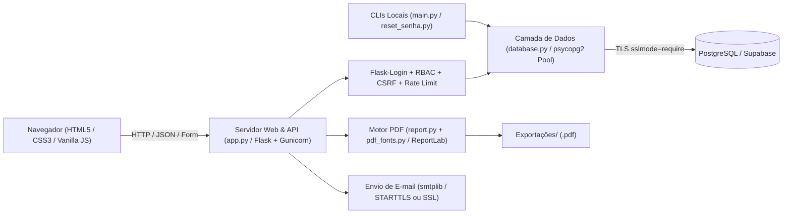
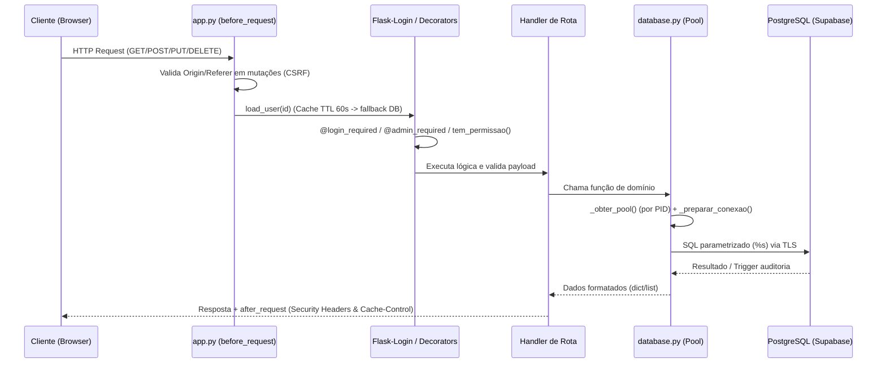
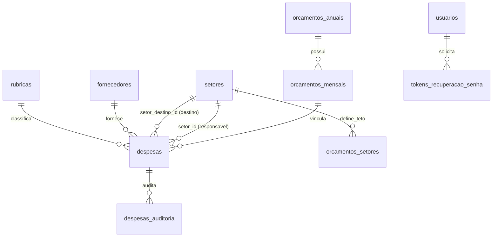

# Arquitetura e Dados — BudgetControl SaaS

> **Versão de referência:** v1.53  
> **Diretório de código-fonte:** `python sections/`  
> **Scripts de banco de dados:** `DB scripts/`

---

## 1. Visão Geral do Sistema

O **BudgetControl SaaS** segue uma **arquitetura monolítica modular em camadas**, projetada para simplicidade operacional, baixa latência com banco gerenciado remoto (Supabase/PostgreSQL) e deploy direto via WSGI (Gunicorn / Render).



---

## 2. Stack Tecnológica

| Camada | Tecnologias | Papel |
|---|---|---|
| **Runtime & Linguagem** | Python 3.10+ | Backend web, acesso a dados, geração de relatórios e CLIs |
| **Web & WSGI** | Flask `>= 3.0`, Gunicorn `>= 21.0` | Roteamento HTTP, templates Jinja2, API REST e servidor de produção |
| **Autenticação & Cripto** | Flask-Login `>= 0.6`, `bcrypt >= 4.0`, `secrets`, `hashlib` (SHA-256) | Sessões seguras, hash de senhas (cost 12) e tokens de recuperação |
| **Banco de Dados** | PostgreSQL (Supabase), `psycopg2-binary >= 2.9` | Persistência relacional, pool thread-safe (`ThreadedConnectionPool`) e triggers |
| **Configuração** | `python-dotenv >= 1.0` (`config.py`) | Carregamento e validação fail-fast de variáveis de ambiente |
| **Relatórios & Docs** | ReportLab `>= 4.0`, `csv` (stdlib) | Geração de PDFs formatados com *Google Sans* e exportação CSV |
| **Frontend** | HTML5, CSS3 (`static/css/style.css`), JavaScript Vanilla | SPA-like dashboard via `fetch`, modais e ordenação client-side |
| **Bibliotecas JS** | SweetAlert2, `html2canvas` (hospedados localmente + fallback CDN) | Diálogos/alertas corporativos e exportação de imagem PNG |

---

## 3. Estrutura de Módulos

```text
Budget_Control/
├── DB scripts/
│   ├── migrationwithupdates.sql   # Constraints, índices, FK e trigger de auditoria
│   ├── add_usuarios.sql           # Tabelas usuarios e tokens_recuperacao_senha + admin inicial
│   ├── inserts.sql / teste.sql    # Carga e testes SQL
│   └── rollbacksec.sql            # Reversão de migrações
├── Exportações/                   # PDFs gerados em tempo de execução
├── Logs/                          # Logs gerados por main.py
└── python sections/
    ├── config.py                  # Leitura de .env, constantes e validação obrigatória
    ├── database.py                # Pool fork-safe, queries SQL, regras de negócio e auth/RBAC
    ├── app.py                     # Aplicação Flask, middlewares de segurança, rotas web e API REST
    ├── report.py                  # Geração de PDFs (resumo, detalhado e resumo por setor)
    ├── pdf_fonts.py               # Registro da fonte Google Sans no ReportLab
    ├── main.py                    # CLI para geração de relatórios PDF
    ├── reset_senha.py             # CLI para redefinição emergencial de senha
    ├── gerar_documentacao.py      # Gerador de documentação DOCX/PDF
    ├── static/                    # CSS modular e JS locais (SweetAlert2, html2canvas)
    ├── templates/                 # index.html, login.html, redefinir_senha.html
    └── fonts/                     # GoogleSans-Regular.ttf, GoogleSans-Bold.ttf
```

---

## 4. Ciclo de Requisições (Request Lifecycle)



### Detalhes do Ciclo
1. **`before_request` (`_proteger_csrf_mesma_origem`):** para `POST`, `PUT`, `DELETE` e `PATCH`, compara `Origin` ou `Referer` contra `request.host` e `X-Forwarded-Host`. Bloqueia requisições cross-origin com HTTP `403`.
2. **Autenticação e Sessão:** `Flask-Login` invoca `load_user(user_id)`, que consulta primeiro `_user_cache` em memória (TTL de `60s`, invalidado em alterações de usuário/permissões) antes de ir ao banco.
3. **Autorização:** rotas protegem acesso via `@login_required`, `@admin_required` e verificações explícitas `current_user.tem_permissao("<chave>")`.
4. **Camada de Dados:** `database.py` obtém conexão via `get_db_connection()` (autocommit habilitado por padrão para reduzir roundtrips remotos em leituras; transações explícitas quando há operações em lote).
5. **`after_request` (`_aplicar_headers_seguranca`):** injeta cabeçalhos de segurança (`X-Content-Type-Options`, `X-Frame-Options`, `Referrer-Policy`, `Permissions-Policy`) e define `Cache-Control` (`immutable` de 7 dias para `/static/`, `/fonts/` e `/favicon.ico`; `no-store` para `/api/` e páginas autenticadas/auth).

---

## 5. Modelo de Dados (PostgreSQL / Supabase)



### Tabelas Principais e Restrições
- **`despesas`:** lançamentos financeiros (`descricao`, `valor >= 0`, `data_compra`, `destino varchar(500)`, `rubrica_id NOT NULL`, `setor_id NOT NULL`, `setor_destino_id`, `fornecedor_id`, `orcamento_mensal_id`).
  - **Índices:** `data_compra`, `rubrica_id`, `setor_id`, `fornecedor_id`, `orcamento_mensal_id`, compostos `(rubrica_id, data_compra)`, `(setor_id, data_compra)` e funcional `(EXTRACT(YEAR FROM data_compra), EXTRACT(MONTH FROM data_compra))`.
- **`setores`:** departamentos/centros de custo (`nome`, `descricao`, `realiza_compras boolean NOT NULL DEFAULT true`).
- **`fornecedores`:** parceiros comerciais (`nome`, `descricao`).
- **`rubricas`:** categorias de despesa (`nome`, `descricao`).
- **`orcamentos_setores`:** tetos mensais por setor (`setor_id`, `ano`, `mes 1..12`, `valor`), com unicidade `UNIQUE(setor_id, ano, mes)`.
- **`orcamentos_anuais` / `orcamentos_mensais`:** estrutura de orçamento consolidado anual/mensal (`uq_orcamento_mensal_anual_mes`, checks `valor >= 0`).
- **`despesas_auditoria`:** log imutável preenchido automaticamente pela trigger `trg_despesas_auditoria` (`fn_auditar_despesa`) em `AFTER INSERT OR UPDATE OR DELETE`, armazenando `dados_anteriores` e `dados_novos` em `jsonb`.
- **`usuarios`:** `username UNIQUE`, `email` (índice único parcial case-insensitive `LOWER(email)`), `senha_hash` (bcrypt), `nome_completo`, `tipo IN ('admin', 'usuario')`, `ativo`, `permissoes jsonb`, `criado_em`, `ultimo_acesso`.
- **`tokens_recuperacao_senha`:** `usuario_id` (`ON DELETE CASCADE`), `token_hash varchar(64) UNIQUE` (SHA-256), `expira_em`, `usado_em`, `ip_solicitante`, `criado_em`.

### Evolução Idempotente de Schema
Além dos scripts em `DB scripts/`, `database.py` executa verificações idempotentes sob demanda com lock por processo (ex.: `_garantir_coluna_setor_destino`), garantindo que colunas como `setor_destino_id`, `realiza_compras` e `destino varchar(500)` existam mesmo em ambientes atualizados sem reexecução manual prévia.

---

## 6. Regras de Dependência entre Camadas

O grafo de imports **deve permanecer estritamente acíclico e unidirecional**:

```text
app.py ──────────┬──▶ database.py ──▶ config.py
                 ├──▶ report.py ────┬──▶ config.py
                 │                  └──▶ pdf_fonts.py
                 └──▶ config.py

main.py ─────────┬──▶ config.py
                 ├──▶ database.py
                 └──▶ report.py

reset_senha.py ──▶ database.py ──▶ config.py
```

### Regras Obrigatórias
1. **`config.py`** não importa nenhum outro módulo do projeto.
2. **`database.py`** pode importar apenas `config.py` e bibliotecas externas/stdlib — **nunca** `app.py` ou `flask`.
3. **`report.py`** e **`pdf_fonts.py`** não acessam o banco diretamente; recebem dados já preparados e não importam `app.py`.
4. **SQL existe exclusivamente em `database.py`** (e scripts em `DB scripts/`). Rotas em `app.py` nunca executam queries SQL diretamente.
5. **Templates HTML** não contêm segredos nem lógica SQL; comunicam-se com o backend apenas via rotas Flask/API REST.

---

## 7. Segurança

| Vetor / Requisito | Controle Implementado |
|---|---|
| **Senhas** | Hash `bcrypt` (cost 12); mínimo de 8 caracteres; dummy hash constante (`_DUMMY_BCRYPT_HASH`) para mitigar enumeração via *Timing Attack*. |
| **Força Bruta** | Rate limiting em memória thread-safe (`_verificar_rate_limit`) no login e na solicitação de recuperação de senha, com limpeza automática de buckets expirados. |
| **Recuperação de Senha** | Token de 256 bits (`secrets.token_urlsafe(32)`), persistido apenas como hash **SHA-256**, uso único, expiração padrão de 30 min e resposta genérica anti-enumeração. |
| **Sessões** | `SESSION_COOKIE_HTTPONLY=True`, `SESSION_COOKIE_SAMESITE="Lax"`, `SESSION_COOKIE_SECURE` configurável por env, expiração de 8 horas. |
| **CSRF** | Validação same-origin de `Origin`/`Referer` em `before_request` para todos os métodos de mutação. |
| **Open Redirect** | `_url_redirecionamento_segura` restringe o parâmetro `next` a caminhos relativos locais sem `scheme`/`netloc`. |
| **SQL Injection** | 100% das queries em `database.py` utilizam placeholders parametrizados (`%s`) do `psycopg2`. |
| **XSS / XML / CSV Injection** | Escape HTML no e-mail (`html.escape`), escape XML no ReportLab (`_esc`), sanitização de células CSV (`_sanitizar_celula_csv` neutralizando prefixos `=`, `+`, `-`, `@`). |
| **Headers HTTP** | `X-Content-Type-Options: nosniff`, `X-Frame-Options: DENY`, `Referrer-Policy: strict-origin-when-cross-origin`, `Permissions-Policy`. |
| **Autorização (RBAC)** | `@admin_required` para gestão de usuários e ações críticas; 8 permissões granulares em `jsonb` normalizadas por `normalizar_permissoes()`. |

---

## 8. Tratamento de Falhas, Resiliência e Operação

### 8.1 Pool de Conexões Fork-Safe e Health-Check
- **Isolamento por PID (`_pool_pid`):** no Gunicorn (múltiplos workers após `fork()`), cada processo cria seu próprio `ThreadedConnectionPool(minconn=1, maxconn=10, sslmode="require")` sob demanda, evitando corrupção de sockets TLS e deadlocks.
- **Keepalives TCP:** `keepalives=1`, `keepalives_idle=20`, `keepalives_interval=10`, `keepalives_count=3`.
- **Health-Check transparente (`_preparar_conexao`):** conexões ociosas por `≥ 15s` executam `SELECT 1;` antes de serem entregues; em caso de queda pelo NAT do Render/Supabase, a conexão é descartada (`putconn(conn, close=True)`) e substituída automaticamente.
- **Pré-aquecimento assíncrono (`preaquecer_pool_async`):** daemon thread aquece o handshake TCP/TLS quando a tela `/login` é acessada.

### 8.2 Fail-Fast e Degradação Graciosa
- **Variáveis obrigatórias (`config.py`):** ausência de `DB_HOST`, `DB_NAME`, `DB_USER` ou `DB_PASSWORD` encerra a inicialização com mensagem explícita (`sys.exit(1)`).
- **SMTP em desenvolvimento:** se `SMTP_HOST` não estiver definido, o link de recuperação de senha é impresso no log do servidor em vez de falhar a operação.
- **Bibliotecas JS locais com fallback:** `SweetAlert2` e `html2canvas` são servidos localmente em `static/js/` com fallback automático para CDN caso o asset local não carregue.
- **Respostas de erro da API:** erros de validação retornam HTTP `400` com `{"erro": "mensagem clara"}`; autorização retorna `403`; não encontrado `404`; exceções inesperadas são registradas via `logging` e retornam HTTP `500` genérico sem expor stack traces ao cliente.
